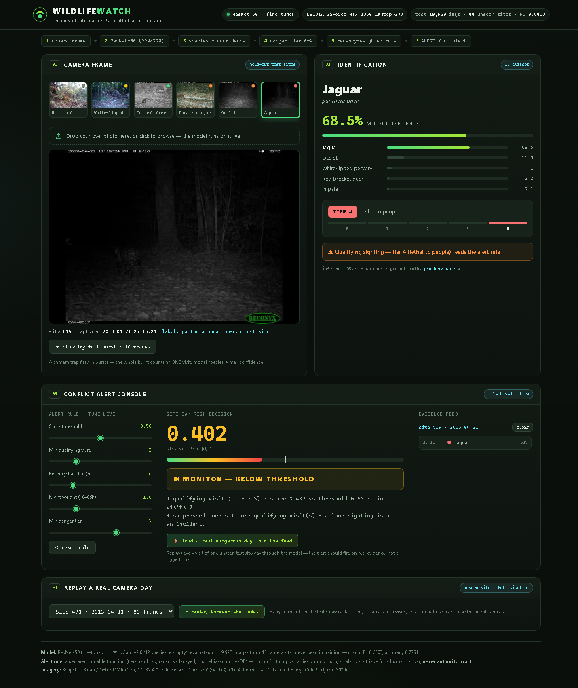
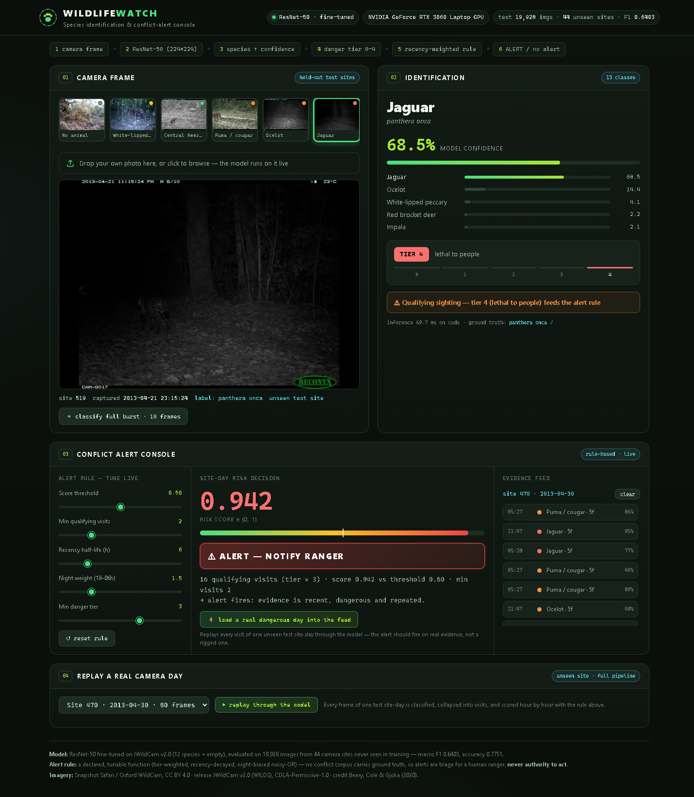
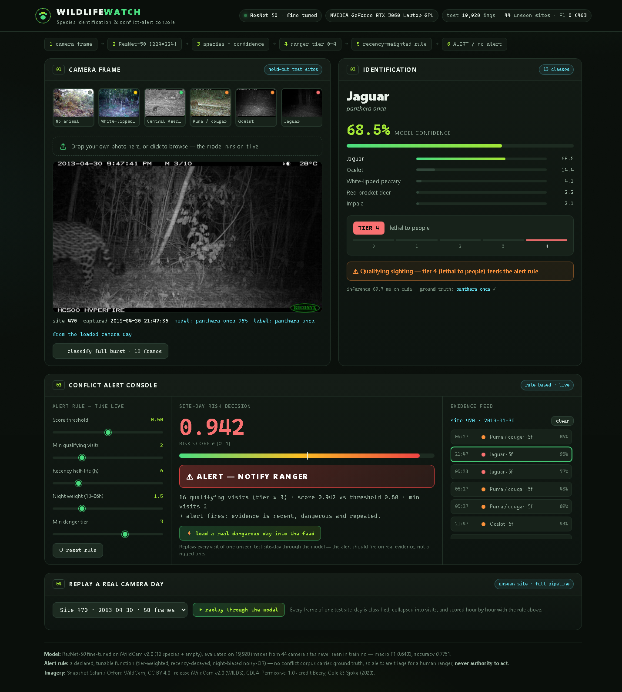
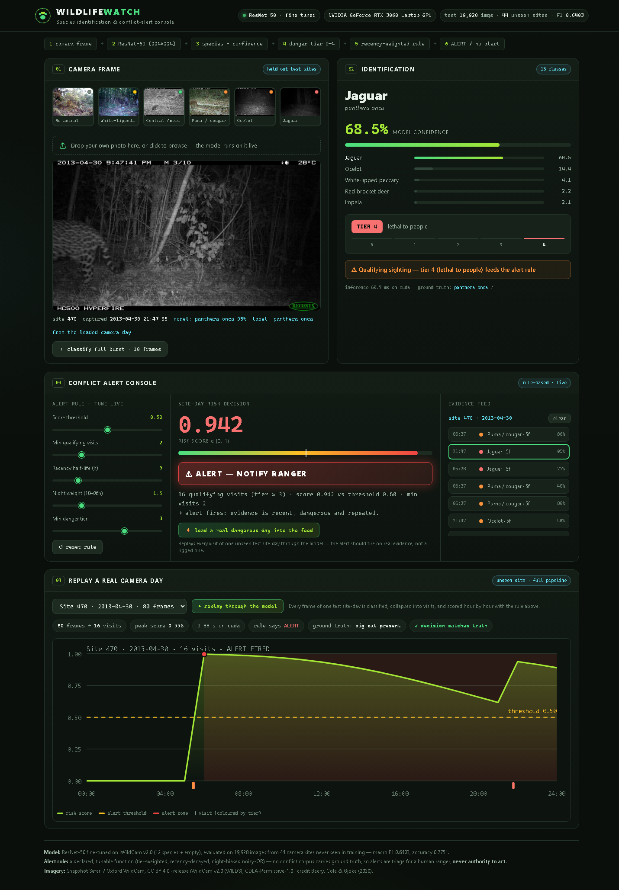

# Wildlife Species Identification & Conflict Alert System

A deep-learning camera-trap system that **identifies wildlife species** from infrared
camera-trap images and turns those detections into a **human–wildlife conflict alert** —
a risk score per camera site that tells a ranger whether to be warned for the next few
hours. Built for CSAI3027P (Deep Learning), Project-Based Evaluation.

> **Honest scope:** alerts are *triage for a human ranger, never authority to act*. No
> camera-trap corpus carries conflict ground truth, so the alert is a declared, tunable
> rule whose behaviour is measured against fair baselines — not a validated risk model.

## Live console

The system ships with a self-contained web console (Flask + vanilla JS, no CDNs, runs
fully offline). Drop in a photo or pick a held-out test frame, and it runs the real
trained model.

| Identification | Alert decision + evidence |
|---|---|
|  |  |

Each alert is backed by clickable evidence — click a visit row to see the actual animal
frame that drove the score:



Replay an entire unseen camera-day through the model, hour by hour:



## Results (held-out test split: 19,928 images from 44 camera sites never seen in training)

| Model | Macro F1 | Accuracy | Notes |
|---|---|---|---|
| Majority-class baseline | 0.020 | 0.342 | always "empty" |
| Random | 0.065 | — | floor |
| Baseline: frozen ResNet-50 + logistic head | 0.6245 | 0.7623 | transfer features alone |
| Naive fine-tune (8 ep, last epoch) | 0.6043 | — | shows careless training backfires |
| **Proposed: fine-tuned + augmentation + label smoothing + best-val restore** | **0.6403** | **0.7751** | ROC AUC **0.9394** |

Detection (YOLOv8n, after removing a 7.28% test-set leak found by a byte-hash audit):
**mAP@0.5 0.9469**, ~26.8 ms/frame edge proxy.

Alert rule, judged at an equal 74-alert budget over 625 test camera-days (47 truly
dangerous): the shipped recency-weighted rule finds **61.7%** of dangerous days vs 38.3%
for a volume baseline and 11.8% for random — while a learned LSTM forecaster collapsed to
2.1%. That failure is reported, not hidden. See `results/notebook08/`.

## Quickstart

```bash
# 1. environment (Python 3.11; needs CUDA for training, runs on CPU for inference)
python -m venv .venv && .venv/Scripts/pip install -r requirements.txt

# 2. dataset — iWildCam v2.0 (WILDS), see docs/DATASET_CARD.md for provenance & licence
#    place images under data/raw/iwildcam_v2.0/train/

# 3. splits are committed under data/splits/; regenerate with src/vision/make_splits.py if needed

# 4. train (produces outputs/checkpoints/finetune_reg.pt) — notebooks 01..07
#    or download weights if published separately

# 5. run the live console
.venv/Scripts/python demo/server.py     # then open http://127.0.0.1:8765
```

Model weights and the 25 GB image corpus are intentionally **not** committed (see
`.gitignore`); they are reproducible from the notebooks.

## Repository layout

```
src/          reusable modules: vision (classifier), sequence (alert rule), from_scratch (syllabus fundamentals)
notebooks/    01 dataset audit → 07 training → 08 alert innovation → 09 error analysis → 10 results showcase
demo/         Flask + vanilla-JS live console (server.py, index.html, run_demo.bat)
docs/         dataset card, model card, source & contribution log, licence evidence, report
configs/      experiment configuration
tests/        gradient-check, alert-rule, and tie-break test suites
results/      small result CSVs and figures that back every quoted number
data/splits/  leakage-safe train/val/test manifests (see DATA_LICENCE.md)
```

## Documentation

- **[info.md](info.md)** — architecture, training, the innovation, baselines, limitations, and dataset provenance in detail.
- **[docs/DATASET_CARD.md](docs/DATASET_CARD.md)** — dataset origin, licence, splits, ethics.
- **[docs/MODEL_CARD.md](docs/MODEL_CARD.md)** — model card, intended/non-intended use, risks.
- **[docs/SOURCE_LOG.md](docs/SOURCE_LOG.md)** — every external dataset, model, paper, and AI assistance, disclosed prompt-wise.
- **[DATA_LICENCE.md](DATA_LICENCE.md)** — licence terms for the committed split manifests.

## Tech stack

PyTorch · torchvision · scikit-learn · pandas · NumPy · Ultralytics YOLOv8 · Flask ·
vanilla JS/CSS. Trained locally on an RTX 3060 (seed 13, bit-reproducible).

## Licence & attribution

- Imagery: **Snapshot Safari / Oxford WildCam**, CC BY 4.0. Release: **iWildCam v2.0 (WILDS)**, CDLA-Permissive-1.0. Credit: Beery, Cole & Gjoka (2020).
- Code in this repository: MIT (see `LICENSE`).

## AI-use disclosure

This project was developed with AI coding assistance. Per the course rules, every use is
disclosed prompt-wise in `docs/SOURCE_LOG.md`, and all concepts, numbers, and design
choices are the author's own work and defensible independently.
